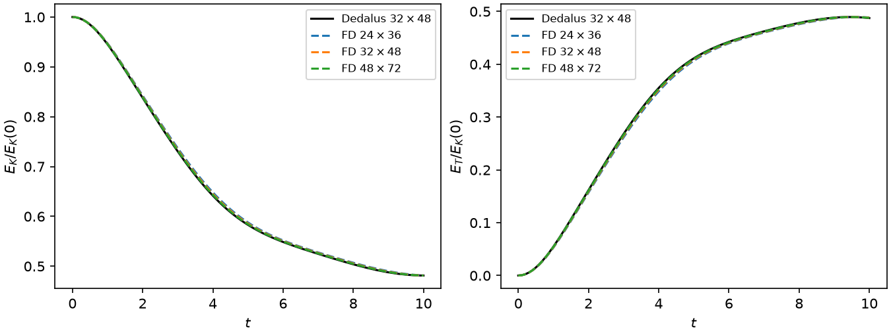

# Torsional shell model and benchmarks

## Equations and boundary conditions

In the dimensionless shell $0.3\le r\le1$, define the cylindrical radius $s=r\sin\theta$, velocity $\mathbf u=s\Omega\mathbf e_\phi$ and magnetic field $\mathbf B=\mathbf B_p+sq\mathbf e_\phi$. For a prescribed, solenoidal $\mathbf B_p$ and constant density and permeability,

$$
\partial_t q=\mathbf B_p\cdot\nabla\Omega+\eta\mathcal L q,\qquad
\partial_t\Omega=s^{-2}\mathbf B_p\cdot\nabla(s^2q)+\nu\mathcal L\Omega,
$$

$$
\mathcal L f=r^{-4}\partial_r(r^4\partial_rf)
 +(r^2\sin^3\theta)^{-1}\partial_\theta(\sin^3\theta\partial_\theta f).
$$

The magnetic term in the momentum equation is the divergence of the Maxwell torque flux $s^2q\mathbf B_p$ divided by $s^2$. The toroidal vector Laplacian is $s\mathcal L q$. The magnetic diffusivity $\eta$ and kinematic viscosity $\nu$ are constant. For $f=(r-r_i)^2(r_o-r)^2$, the flux is $\psi=Cf\sin^2\theta$ with $B_r=(r^2\sin\theta)^{-1}\partial_\theta\psi$ and $B_\theta=-(r\sin\theta)^{-1}\partial_r\psi$. Both poloidal components vanish at the radial walls. The resistive wall condition is $B_\phi=0$ and the viscous condition is $\partial_r\Omega=0$. At the axis, $\Omega$ and $q$ are regular even scalars and the physical toroidal components vanish.

Initially $q=0$. The angular velocity is proportional to $[1+0.18\cos(2\pi(r-r_i)/(r_o-r_i))]P_2(\cos\theta)$, with its rigid component removed and its $s^2dV$-weighted RMS set to one. The field normalization sets the volume RMS of $\mathbf B_p$. Default finite differences use their own quadrature for normalization. Matched comparisons use the same continuous normalization and profiles in both solvers.

For length $L$, density $\rho_0$ and initial differential-rotation scale $\Delta\Omega$, the units of time, velocity and field are $\Delta\Omega^{-1}$, $L\Delta\Omega$ and $\sqrt{\mu_0\rho_0}L\Delta\Omega$. The units of diffusivity and energy are $L^2\Delta\Omega$ and $\rho_0L^5\Delta\Omega^2$. A dimensional time requires a physical shear scale consistent with the chosen length, density and field.

## Discretization and diagnostics

Finite differences are cell-centered. The torque is the flux difference from face-integrated $s^2\mathbf B_p$ and face-averaged $q$. Winding is its negative adjoint in the exact cell moments $M=\int_{\rm cell}s^2dV$. Diffusion and viscosity use conservative face fluxes with half-cell Dirichlet closure for $q$ and zero normal derivative for $\Omega$. Ordinary volume diagnostics use $M/s_{\mathrm{center}}^2$. Classical RK4 is explicit and requires a stable timestep.

Dedalus evolves $\mathbf U=s\Omega\mathbf e_\phi$ and $\mathbf T=sq\mathbf e_\phi$ on a spherical `ShellBasis` with one azimuthal mode. Its coupling terms are $\nabla\times(\mathbf U\times\mathbf B_p)$ in induction and $(\nabla\times\mathbf T)\times\mathbf B_p$ in momentum. Axisymmetry keeps the coupling in the toroidal subspace. The solver uses 3/2 dealiasing and RK443 with implicit diffusion and explicit coupling. Diffusive fields use two surface-vector tau terms in the second derivative basis. The velocity condition is $r\partial_r\mathbf U-\mathbf U=0$. Ideal fields have no diffusive tau terms. Compatible ideal wall values follow from the continuum equations and are monitored in the spectral solution. The projected poloidal field has a measured RMS divergence of order $10^{-15}$ at $24\times36$. [Dedalus tau method](https://dedalus-project.readthedocs.io/en/latest/pages/tau_method.html)

For a closed shell,

$$
E_K=\tfrac12\int s^2\Omega^2dV,\qquad E_T=\tfrac12\int s^2q^2dV,\qquad
J=\int s^2\Omega\,dV,
$$

$$
\dot E_K+\dot E_T=-\eta\int|\nabla\times\mathbf T|^2dV
-\nu\int s^2|\nabla\Omega|^2dV,\qquad \dot J=0.
$$

The finite-difference exchange cancels algebraically and its losses use the quadratic forms of the discrete diffusion operators. Dedalus integrates the curl and strain losses. The verification script also integrates interpolated snapshots with independent quadrature and differentiation. Both solvers report the cumulative energy change plus cumulative dissipation minus work supplied to the magnetic field in the no-feedback calculation, divided by the initial total energy (including the static poloidal energy). They integrate losses and supplied work with per-step trapezoidal quadrature. Turning off feedback holds the flow fixed when $\nu=0$.

## Benchmarks

At $t=0.2$, the relative weighted $L^2$ errors in the spectral $B_\phi$ against ideal continuum winding are $6.11\times10^{-8}$, $6.41\times10^{-11}$ and $2.44\times10^{-12}$ at $12\times18$, $16\times24$ and $24\times36$. The finite-difference tests independently refine the smooth continuum winding and Maxwell force, including polar and wall-adjacent cells.

For resistive decay use $q=[j_1(kr)+a y_1(kr)]/r$ with a zero at each radial wall. The first root is $k\approx5.042727$ and the amplitude decays as $\exp(-\eta k^2t)$. At $\eta=0.01$ and $t=0.2$, finite-difference relative $L^2$ errors at $16\times24$, $32\times48$ and $64\times96$ are $1.63\times10^{-3}$, $4.28\times10^{-4}$ and $1.08\times10^{-4}$. Spectral errors on the three winding grids are $9.51\times10^{-10}$, $8.01\times10^{-13}$ and $2.52\times10^{-13}$. The viscous test uses the same radial function for $\Omega$ with Neumann conditions, giving $k\approx5.961246$ and amplitude $\exp(-\nu k^2t)$. Rigid rotation is a viscous null solution. A matrix-exponential benchmark checks RK4 against the same spatial diffusion operator.

In the resistive field-strength sweep ($\eta=2\times10^{-5}$), the finite-difference half-times are 16.5, 8.3 and 4.2, and the Dedalus half-times are 16.4, 8.3 and 4.2. The reference shell crossing times $(r_o-r_i)/B_{p,\mathrm{rms}}$ are 20, 10 and 5. The samples are spaced by 0.1 and the half-times are threshold crossings on this grid. The ideal equations depend on the product $B_{p,\mathrm{rms}}t$ for fixed geometry and initial shear. At fixed nonzero $\eta$, the ratio of the diffusion and Alfvén times changes with field strength. Ideal energy exchange can be reversible, and the half-time is specific to this shell and initial condition.

At $B_{p,\mathrm{rms}}=0.07$, increasing $\eta$ reduces and advances the first toroidal-energy maximum:

| $\eta$ | FD peak $E_T$ (48 × 72) | FD peak time |
| ---: | ---: | ---: |
| 0 | 0.43148 | 10.0 |
| $2\times10^{-5}$ | 0.40902 | 9.5 |
| $10^{-4}$ | 0.35180 | 7.9 |
| $5\times10^{-4}$ | 0.25487 | 5.2 |

With feedback disabled and $\nu=0$, kinetic energy stays constant while the shear supplies toroidal field energy. In the resistive finite-difference control, there is no half-time through $t=30$. With feedback, the $B_{p,\mathrm{rms}}=0.07$ run has a maximum normalized energy-budget residual of $2.86\times10^{-9}$ through $t=30$.

## Resolution and scope

For the coupled run at $t=10$ and $\eta=2\times10^{-5}$, the $48\times72$ finite-difference solution differs from the $64\times96$ finite-difference reference by 1.54% in $u_\phi$ and 1.47% in $B_\phi$ (relative weighted $L^2$). Against the matched $32\times48$ spectral reference, the differences at $24\times36$, $32\times48$ and $48\times72$ are 11.7%, 7.45% and 3.77% in $u_\phi$, and 11.2%, 7.15% and 3.56% in $B_\phi$. At fixed $24\times36$ spectral resolution, reducing the timestep from 0.02 to 0.01 reduces the weighted toroidal-field difference from $1.21\times10^{-6}$ to $1.34\times10^{-7}$ relative to the 0.005 step. Spatial error dominates at these settings.



*Energy exchange at $B_{p,\mathrm{rms}}=0.07$ and $\eta=2\times10^{-5}$. Each run uses its own initial kinetic energy as the energy unit.*

The matched $32\times48$ spectral run has a peak $E_T$ of about 0.40901 and a normalized budget residual of order $10^{-6}$ through $t=10$. The coarser sweep reaches residuals of order $10^{-3}$ and shows angular-momentum drift at later times. Global maximum errors can be nonmonotone near the poles, including within the domain beyond the outermost Gauss nodes. At $t=12$ the maximum ideal toroidal wall error drops from 0.747 at $24\times36$ to 0.135 at $32\times48$, compared with a bulk peak $|B_\phi|$ of about 1.26. The resistive half-time sweep imposes the toroidal wall value explicitly. The early integral results support the energy-transfer and scaling claims. Late ideal traces, phase-mixed gradients and pointwise extrema require further refinement.

The model constrains the flow to be torsional and fixes the poloidal field. Its continuum torque and winding follow the Newtonian terms in [Liu & Shapiro (2004), Eqs. 20–22](https://arxiv.org/abs/astro-ph/0312038). The shell geometry, confined field, conservative finite-difference solver and matched Dedalus experiments define the numerical study here. [Shapiro (2000)](https://arxiv.org/abs/astro-ph/0010493) and [Thampan (2004)](https://arxiv.org/abs/astro-ph/0408443) provide braking and phase-mixing context. The model omits meridional force balance, stratification, exterior transport and relativistic effects. More complete stellar simulations and transport physics are discussed by [Duez et al. (2006)](https://arxiv.org/abs/astro-ph/0605331) and [Goldreich & Reisenegger (1992)](https://articles.adsabs.harvard.edu/pdf/1992ApJ...395..250G). [Alfvén (1942)](https://doi.org/10.1038/150405d0) describes the underlying wave mechanism.

The spectral implementation uses [Dedalus](https://arxiv.org/abs/1905.10388). Optional [PyVista](https://doi.org/10.21105/joss.01450) figures evaluate the reconstructed Cartesian vectors at sampled azimuths. Magnetic field lines integrate $d\mathbf X/d\ell=\mathbf B/|\mathbf B|$ from selected seeds. Evolution frames use the same signed scales and saved physical times. For the camera orbit the physical state is fixed.

## Meridional field evolution

[Archived field evolution](figures/field_evolution.png) shows the earlier finite-difference run, which used a centered winding and adjoint discretization. Its sampled kinetic-energy half-time was 8.2. In the archived source directory, `python run_braking.py` produces the snapshots and `python -c 'from make_figures import field_evolution; field_evolution()'` plots them.

[Release field evolution](figures/field_evolution_v020.png) recomputes the four snapshots with the face-integrated finite-difference solver in this release. Both runs use a $48\times72$ grid on $0.3\le r\le1$, $B_{p,\mathrm{rms}}=0.07$, $\eta=2\times10^{-5}$, $\nu=0$, Maxwell feedback, and $\Delta t=0.005$. The initial shear has unit weighted RMS and radial contrast 0.18. Diagnostics are sampled every 0.1 and 13 snapshots are spaced uniformly through $t=80$. Color shows signed $B_\phi$. Dark contours show poloidal flux, and white contours show $\Omega$ at levels chosen per panel. The $t=80$ panels illustrate the late field at this resolution.

```bash
python scripts/plot_field_evolution.py --output ../nsinduct-output/field_evolution_v020.png
```
